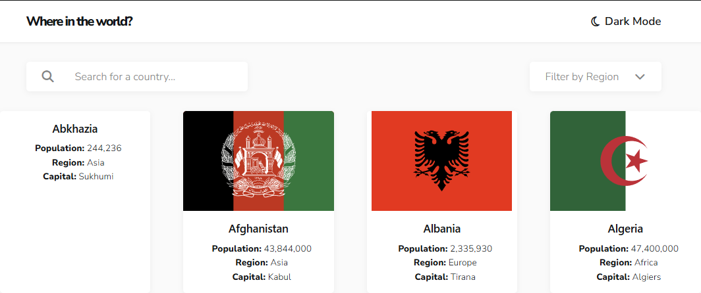
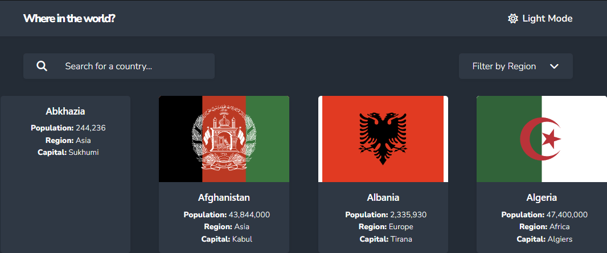
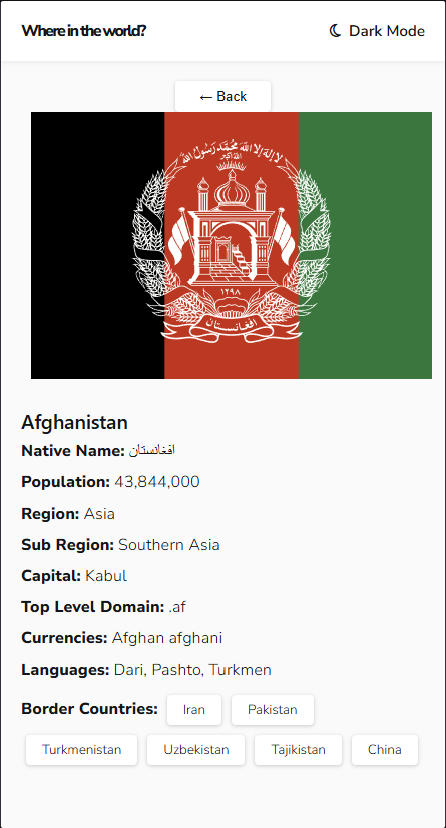

```markdown
### REST Countries Explorer

## Project Overview

REST Countries Explorer is a React application that displays information about countries around the world. Users can browse country information, search by country name, filter by region, and view additional details by selecting a country.

The application retrieves country data from the REST Countries API and provides a dark/light theme switcher.

## Features

- Display country information in reusable cards.
- Search countries by name.
- Filter countries by region.
- View detailed information about a selected country.
- Navigate between countries using border-country links.
- Switch between light and dark themes.
- Save the selected theme using localStorage.
- Delay search filtering using a custom debounce hook.
- Display loading and error messages while retrieving country data.

## Starting Point, Code Reuse, and Enhancements

This project was developed using an existing REST Countries project as its starting point. I reused and built upon existing components, types, styling, and functionality rather than recreating the entire application from scratch.

# Existing Functionality Reused

I retained the existing country listing and country details functionality, including the following components:

- `Header`
- `SearchBar`
- `RegionFilter`
- `CountryList`
- `CountryCard`
- `CountryDetails`

This allowed me to preserve existing features such as:

- Searching for countries by name.
- Filtering countries by region.
- Viewing individual country details.
- Navigating to neighboring countries through border links.


## New Functionality and React Concepts Introduced

I extended the application by introducing additional React concepts and functionality:

- **API Integration and Data Fetching**
  - Used `useEffect` and `fetch()` in `App.tsx` to retrieve country data through the `/api/countriesApi` endpoint.
  - The serverless function in `api/countriesApi.ts` communicates with the REST Countries API.
  - Managed loading and error states using `useState`.

- **Data Transformation**
  - Created `mapApiCountry()` in `src/utils/countryMapper.ts` to transform the API response into the existing `Country` type used by the components.

- **Pagination**
  - Implemented API requests using offsets to retrieve all available countries in batches.

- **Custom Hooks**
  - Created `useLocalStorage` to persist the selected theme in browser storage.
  - Created `useDebounce` to delay country search filtering until the user stops typing.

### Theme Persistence

- **Custom Hook (`useLocalStorage.ts`)**
  - Used `useState` to manage the stored value (the selected theme).
  - Used `localStorage.getItem()` to retrieve the saved theme when the application loads.
  - Updated the React state and saved the new theme preference to localStorage whenever the user switches themes.

- **Header Component (`Header.tsx`)**
  - Updated the component to use the `useLocalStorage` custom hook instead of managing theme state directly with `useState`.
  - Used `useEffect` to apply the selected theme by adding or removing the `dark-mode` CSS class on the document body.
  - Used `setTheme` to switch between light and dark modes.


## Learning and Implementation

While reusing the existing application structure, I focused on understanding how the components worked, how data flowed between them through props, and how the new functionality could be added while preserving the existing features.


## React Concepts and Where They Are Used

### 1. Components and Reusability

**Files/Components:** `Header.tsx`, `SearchBar`, `RegionFilter`, `CountryList`, `CountryCard`, and `CountryDetails`.

The application is divided into smaller components, each responsible for a particular part of the user interface. This makes the code easier to organize, maintain, and reuse.

### 2. Props and TypeScript

**Files:** Component files and `src/types/Country.ts`.

Props are used to pass data and event handlers between parent and child components. TypeScript types help define the expected structure of country data and component properties, reducing mistakes and making the code easier to understand.

### 3. State Management with useState

**File:** `src/App.tsx`

`useState` manages application data such as the country list, search text, selected region, selected country, loading status, and error messages.

It allows the interface to update when users search, select a region, or open a country's details.

### 4. Side Effects with useEffect

**Files:** `src/App.tsx` and `src/components/Header/Header.tsx`.

- In `App.tsx`, `useEffect` retrieves country data when the application loads.
- In `Header.tsx`, `useEffect` applies the selected theme to the document body.

### 5. API Integration and Data Transformation

**Files:** `api/countriesApi.ts`, `src/utils/countryMapper.ts`, and `src/App.tsx`.

The application retrieves country data through a serverless API endpoint. The serverless function communicates with the REST Countries API without exposing the API key in browser-side code.

The API returns data in its own structure. The `mapApiCountry()` function transforms that response into the existing `Country` structure used by the React components.

Pagination is used to retrieve all available countries in batches.

### 6. Controlled Components and Event Handling

**Components:** `SearchBar` and `RegionFilter`.

The search input is controlled by React state. When the user types, the search value is updated through an event handler.

The region filter allows users to select a region and updates the displayed countries accordingly.

### 7. Conditional Rendering

**Files:** `src/App.tsx` and related display components.

Conditional rendering displays different content depending on application state. For example, the application displays a loading message while retrieving data, an error message if the request fails, and the country list after the data is available.

It also displays the selected country's details when a country is clicked.

### 8. Lists and Keys

**Components:** `CountryList` and `CountryCard`.

The `map()` method is used to display multiple country cards from the country data array. Unique keys help React identify list items when rendering and updating the list.

### 9. Custom Hooks

**Files:** `src/hooks/useLocalStorage.ts` and `src/hooks/useDebounce.ts`.

- **useLocalStorage:** A reusable generic hook that stores and retrieves values from browser localStorage. It is used to remember the user's selected theme even after refreshing the page.
- **useDebounce:** A reusable generic hook that delays updating a value until the user stops changing it for a specified amount of time. It is used in the country search to delay filtering until the user pauses typing.

### 10. Responsive Design 

**File:** `src/App.css`

The application uses CSS styling and media queries to adjust the layout for different screen sizes.

I checked the basic responsive behavior of the application and verified that the main interface remains usable at smaller viewport sizes.

The responsive checks included:

- **Header:** Checked that the application title and theme switcher remain visible and properly positioned.
- **Search Bar:** Checked that the search input fits within the available screen width.
- **Region Filter:** Checked that the region dropdown remains visible and usable.
- **Country Listing:** Checked that country cards adjust to the available screen width without causing horizontal overflow.
- **Country Details:** Checked that the country flag, information, and border-country buttons remain readable and usable.

The responsive styling helps maintain a consistent layout and user experience across different screen sizes.

### 11. Theme Switcher and Context API

**Files:** `src/context/ThemeContext.tsxx` , `src/main.tsx`,  `src/components/Header/Header.tsx`,  `src/hooks/useLocalStorage.ts`

- **Light/Dark Theme Switcher:** Allows users to switch between light and dark themes.
- **Context API:** Uses `ThemeContext` to share the selected theme and `toggleTheme` function across the application.
- **Theme Persistence:** Uses the `useLocalStorage` custom hook to remember the selected theme after a browser refresh.


## Challenges Faced and How I Resolved Them

### 1. Integrating the REST Countries API

One challenge was replacing the existing local country data source with data retrieved from an external API.

I created a serverless API endpoint to communicate with the external API and keep the API key on the server side. I also used a mapper function to convert the API response into the country structure already used by the application.

### 2. Retrieving All Countries

The API returned country information in batches rather than providing all countries in a single response.

I implemented pagination using the API's offset and metadata fields. The application continues requesting the next batch until all available countries have been retrieved.

### 3. Persisting the Theme Selection

I wanted the application to remember the user's theme preference after a browser refresh.

I created the `useLocalStorage` custom hook to store the theme in localStorage. During testing, I encountered a JSON parsing error because an older theme value had been stored as plain text. I resolved it by removing the outdated value and allowing the new hook to store values in JSON format.

### 4. Implementing Debounced Search

Initially, I needed a way to avoid running the country filter immediately after every keystroke.

I created the `useDebounce` custom hook using `useState`, `useEffect`, `setTimeout`, and `clearTimeout`. This delays filtering until the user pauses typing, making the search behavior more efficient.


## Testing Completed

Performed functional testing of the application's main features to verify that they work as expected.

- **API Integration:** Verified that country data is successfully retrieved from the REST Countries API.
- **Pagination:** Verified that all 254 countries are retrieved across multiple API requests.
- **Country Search:** Tested searching by country name and verified the debounced search behavior.
- **Region Filtering:** Checked that selecting a region displays the corresponding countries.
- **Country Details:** Tested opening individual country details and navigating between neighboring countries.
- **Theme Switcher:** Tested switching between light and dark themes.
- **Theme Persistence:** Verified that the selected theme remains active after refreshing the browser.
- **Context API:** Tested that the theme functionality continues to work after implementing ThemeContext and ThemeProvider.
- **Responsive Design:** Checked the basic layout and usability at smaller screen sizes.
- **Production Build:** Ran `npm run build` successfully, with no TypeScript compilation errors.


## Deployment

**Platform:** Vercel

**Deployment Status:** Pending

The application will be deployed to Vercel.

Before deployment:
- Configure the `API_Key` environment variable for the Production environment in Vercel.
- Verify that the serverless API function can access the key using `process.env.API_Key`.

After successful deployment:
- Add the live application URL to this section.
- Verify that country data loads, search and region filtering work, and the theme switcher persists after refreshing the page.

Application Screenshots

Light Mode




Dark Mode



Country Details


```
